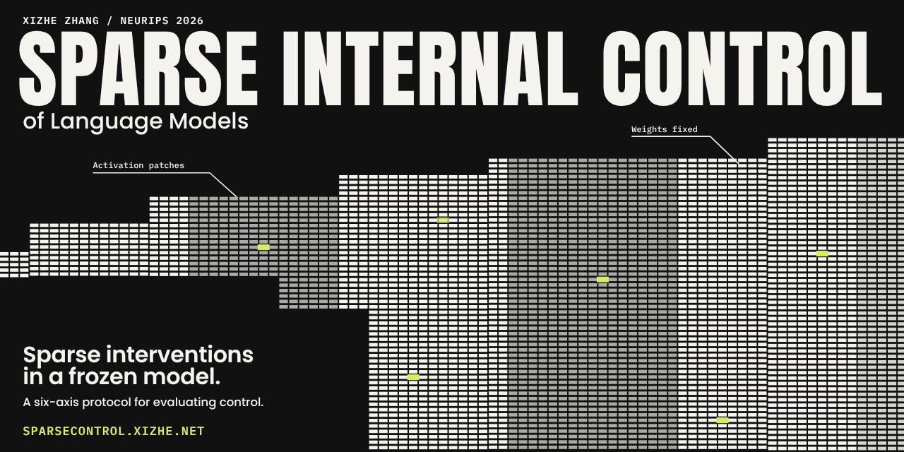
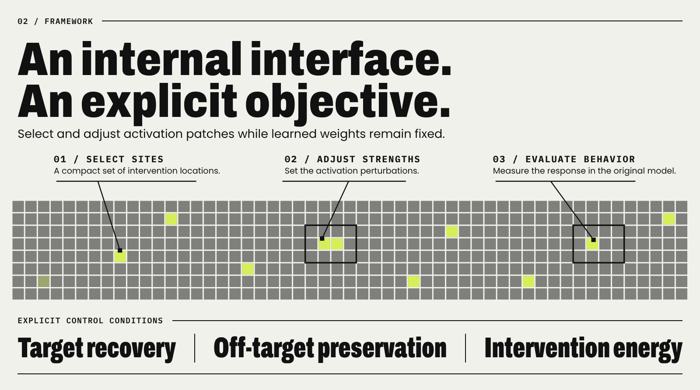
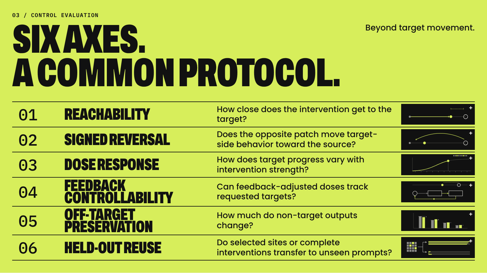
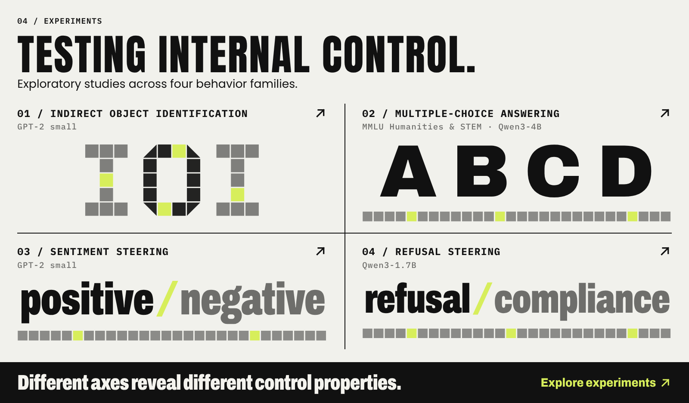

<a href="https://sparsecontrol.xizhe.net"></a>

<div align="center">

# Sparse Internal Control of Language Models

**Xizhe Zhang** · NeurIPS 2026

[](https://sparsecontrol.xizhe.net)
[](https://sparsecontrol.xizhe.net/paper.pdf)
[](https://sparsecontrol.xizhe.net/theory.html)
[](https://sparsecontrol.xizhe.net)
[](https://github.com/zxzok/sparse-internal-control/actions/workflows/replay.yml)
[](LICENSE)
[](pyproject.toml)

**[Website](https://sparsecontrol.xizhe.net)** &nbsp;·&nbsp; **[Paper (PDF)](https://sparsecontrol.xizhe.net/paper.pdf)** &nbsp;·&nbsp; **[Theory](https://sparsecontrol.xizhe.net/theory.html)** &nbsp;·&nbsp; [Quick start](#quick-start) &nbsp;·&nbsp; [Experiment guide](docs/experiments.md) &nbsp;·&nbsp; [Reproduction scope](REPRODUCIBILITY.md) &nbsp;·&nbsp; [中文](README.zh-CN.md)

</div>

> [!TIP]
> **Project website: [sparsecontrol.xizhe.net](https://sparsecontrol.xizhe.net)**. The framework and the six axes, with interactive animations, and the [mathematical model](https://sparsecontrol.xizhe.net/theory.html) behind them.

Code and measurement records for **Sparse Internal Control of Language Models** by **Xizhe Zhang** (2026).

## The idea

Sparse internal control steers a frozen language model through a few internal sites at inference time. An intervention adds scaled directions to a handful of activations during the forward pass; the weights stay fixed, and setting the strengths to zero recovers the original model. Choosing the sites is posed as a control problem: which drivers, how hard, and under what guarantees.

<a href="https://sparsecontrol.xizhe.net/#framework"></a>

| Step | What happens | In symbols |
|---|---|---|
| **Specify** | Pick a readout, a target for each prompt, and off-target prompts that must not move | $q_i = \tau_i - b_\theta(x_i)$ |
| **Actuate** | A few site and direction pairs receive strengths $\beta$; the weights $\theta$ stay frozen | $h_s(x) \leftarrow h_s(x) + \sum_{v:\, s_v = s} \beta_v\, u_v(x)$ |
| **Certify** | Target error, off-target change and energy are checked together in the full model | $\mathrm{Rel}_{\mathrm{tar}} \le \varepsilon,\ L_{\mathrm{off}} \le \delta,\ E \le \kappa$ |

The selectors solve one sparse program, picking the fewest, cheapest drivers whose intervention passes the certificate:

```math
\min_{\beta \in \mathbb{R}^{M}}\ \lVert\beta\rVert_{0,c} + \lambda_E\, E(\beta) \quad \text{subject to}\quad \beta \text{ is an } (\varepsilon, \delta, \kappa) \text{ certificate}
```

**Driver-OMP** fits the requested displacement by sparse residual fitting. **Coverage-Driver** adds candidates by saturated coverage across prompts. Near the unpatched model, reaching a target reduces to a span test and a minimum energy; the [theory page](https://sparsecontrol.xizhe.net/theory.html) works through it with an interactive controllability explorer.

## Six axes, one protocol

One push is a demo. Control means you can **hit** a target, **undo** it, **dial** it, **track** it, **spare** everything else, and **reuse** it on prompts you have never seen.

<a href="https://sparsecontrol.xizhe.net/#protocol"></a>

| | Axis | Question | Passes when |
|---|---|---|---|
| hit | **Reachability** | How close does the intervention get to the target? | $\mathrm{Rel}_{\mathrm{tar}}(1) \le 0.4$ on held-out readouts |
| undo | **Signed reversal** | Does the opposite patch move target-side behavior toward the source? | $\mathrm{Reversal}(\beta) \ge 2$ after applying $-\beta$ to the target-side input |
| dial | **Dose response** | How does target progress vary with intervention strength? | Signed Spearman $\rho \ge 0.95$ over ten doses |
| track | **Feedback controllability** | Can feedback-adjusted doses track requested targets? | Final error within $\tau_{\mathrm{ctrl}}$: 0.3 for IOI and MCQA, 0.1 for Refusal |
| spare | **Off-target preservation** | How much do non-target outputs change? | $\mathrm{KL} \le 0.001$, as a seed mean and on every prompt |
| reuse | **Held-out reuse** | Do selected sites or complete interventions transfer to unseen prompts? | Reported as continuous recovery, with refit or frozen strengths |

Each axis has its own module in [src/sparse_control/metrics/](src/sparse_control/metrics/), so any intervention with a support, base strengths and a direction rule can be scored the same way.

## What the axes revealed

- **Direction information sets the profile.** With evaluation-pair directions, Coverage-Driver passes reachability in 8/8 seeds on MCQA and Sentiment; with training-mean directions, in none. Feedback on MCQA Humanities drops from 46/48 to 8/48 hits.
- **Ordered is not reversible.** All 48 Refusal dose curves have $\rho = 1$, yet none passes signed reversal.
- **Preservation is not free.** No MCQA or Sentiment seed keeps $\mathrm{KL} \le 0.001$ on the off-target panel; on Refusal, Driver-OMP passes 4/8 seeds by the mean rule.
- **Sites travel, frozen interventions do not.** Module-level MCQA recovers 0.992 on unseen prompts with refit strengths (Humanities) and 0.021 when the whole intervention is frozen.

## Experiments

<a href="https://sparsecontrol.xizhe.net/#experiments"></a>

| Behavior family | Model | Main panels |
|---|---|---|
| Indirect object identification (IOI) | GPT-2 small | 64 paired prompts |
| Sentiment steering | GPT-2 small | 16 pairs, fit/eval 8/8; 16 positive and 16 negative templates for dose |
| Multiple-choice answering (MMLU Humanities, STEM) | Qwen3-4B | 24 questions per subject, fit/eval 12/12 |
| Refusal steering | Qwen3-1.7B | 20 pairs, fit/eval 10/10 |

Every registered series, including the model comparisons on Qwen3-8B and Mistral-7B, is listed in the [experiment guide](docs/experiments.md).

## What is in the repository

**21** experimental series · **272** source, target and patched readout triples · **3,072** prompt and seed KL measurements · **162** numerical rows checked by `verify`

| Material | Contents |
|---|---|
| Experimental code | Selection methods, activation adapters, task construction, model runners and metrics |
| Configurations | 21 experimental series, model profiles and available input/control identities |
| Formal reachability | 272 complete source/target/patched task-readout triples, 39 groups and 195 threshold classifications |
| Preservation | 3,072 prompt–seed KL measurements |
| Result calculations | 13 numerical tables, three definition/configuration tables, threshold and Sentiment displacement sensitivity, and supporting statistics |

The measurements underlying the paper's figures are indexed in [experiments/figure_records.json](experiments/figure_records.json). Plotting code, rendered figures, model weights and full-vocabulary logit arrays are not included.

## Quick start

Recalculate every table and statistic from the saved measurements, on CPU, without a model or a GPU.

For a downloaded ZIP, extract it and enter its `sparse-internal-control` directory; skip the clone command below. Use Python 3.12. These calculations run on CPU without loading a model or requiring a GPU. Keep environments and generated outputs outside the checkout.

```bash
git clone https://github.com/zxzok/sparse-internal-control.git
cd sparse-internal-control

python3.12 -m venv ../sic-replay-env
source ../sic-replay-env/bin/activate
python -m pip install -r requirements/replay.lock.txt
python -m pip install --no-deps -e .

python -m sparse_control check-release --manifest
python -m sparse_control reproduce --output ../paper-replay
python -m sparse_control verify --output ../paper-replay
python -m pytest -q
```

On Windows, activate the environment with `..\sic-replay-env\Scripts\Activate.ps1` in PowerShell.

Calculations use the Python standard library; the lock file installs test dependencies. Model-dependent tests skip when their dependencies or explicit model fixture are absent. GitHub Actions runs this CPU-only record-replay path.

Generated outputs mirror [results/](results/). The `verify` command checks all requested CSV, JSON and TeX files, compares 162 numerical rows and 15 supporting values with independently transcribed paper values, and checks formal residuals and threshold classifications with a separate arithmetic implementation. It also checks static Tables 1 and G.2 and all artifact labels against the manuscript transcription in `experiments/paper_reference.json`. Its reported scope is `tabular_saved_records`.

For a subset, pass the same artifact IDs to both commands:

```bash
python -m sparse_control reproduce --artifacts formal_reachability_samepanel,formal_reachability_heldout --output ../reachability-replay
python -m sparse_control verify --artifacts formal_reachability_samepanel,formal_reachability_heldout --output ../reachability-replay
```

Use a new output directory for each run. Missing files, changed values and mismatched verification scopes cause failure.

## Running model experiments

Model execution uses a separate environment and an explicit [execution profile](experiments/execution_profiles.json). See [experiment recipes](docs/experiments.md) for registered stages and [compute resources](docs/compute_resources.md) for software and hardware details.

<details>
<summary><b>Example: a CUDA head-level run</b></summary>

For example, a CUDA head-level run uses:

```bash
python3.12 -m venv ../sic-model-env
source ../sic-model-env/bin/activate
python -m pip install -r requirements/model-cuda_head_fp32.lock.txt
python -m pip install --no-deps -e .

python -m sparse_control run --experiment mcqa_humanities_head --stage nominal --profile cuda_head_fp32 --seeds 0 --plan
python -m sparse_control run --experiment mcqa_humanities_head --stage nominal --profile cuda_head_fp32 --seeds 0 --output ../humanities-fixed
```

The first run command prints the resolved plan without loading a model. The second evaluates saved supports and coefficients at nominal dose, checking stored inputs and available source/target baselines first. Model assets must be available locally or accessible through their listed Hugging Face repositories.

Fixed-intervention evaluation and full fitting are separate workflows. `--stage full` runs the registered fitting producer; `--stage fit` aliases that full sequence. Fresh outputs do not replace the supplied paper measurements.

</details>

## Interpreting the results

<details>
<summary><b>Normalization, direction conditions and scope</b></summary>

- **Normalization:** `Rel_tar` is normalized by source-to-target displacement; `R_clean` is normalized by clean target output. Table 2 reports same-panel `Rel_tar(1)` from `formal_reachability_samepanel`; the supplemental `nominal_reconstruction` table reports `R_clean`. The two metrics are not interchangeable.
- **Direction conditions:** evaluation-pair directions (P) use activation contrasts from evaluation pairs; training-mean directions (F) use the fitting split. Feedback can adapt dose even with fixed F directions.
- **Sentiment:** unpaired dose response and paired fixed-dose reuse are separate experiments; feedback is not separately evaluated.
- **Preservation:** the reported statistics are reproduced from supplied prompt-level KL measurements. Recomputing these measurements from model outputs requires running the preservation experiments.
- **Scope:** record replay checks calculations from supplied measurements; it does not establish full model replication. Missing original input or execution identities are documented in [REPRODUCIBILITY.md](REPRODUCIBILITY.md).

</details>

## Repository guide

| Path | Purpose |
|---|---|
| [configs/](configs/) | Per-series settings and experiment parameters |
| [experiments/](experiments/) | Experiment, artifact, model and data registries |
| [src/sparse_control/](src/sparse_control/) | Selection, adapters, tasks, metrics, runners and reporting |
| [data/](data/) | Evaluation inputs, saved interventions and measurements |
| [results/](results/) | Supplied tables, statistics and comparison targets |
| [tests/](tests/) | Metric, input/profile, output coverage and corruption checks |
| [docs/](docs/) | Methods, data dictionary, recipes, resources and attribution |

## Citation

To cite the paper:

```bibtex
@inproceedings{zhang2026sparse,
  title     = {Sparse Internal Control of Language Models},
  author    = {Zhang, Xizhe},
  booktitle = {Advances in Neural Information Processing Systems},
  year      = {2026}
}
```

The author of the accompanying paper is Xizhe Zhang. To cite this software release:

```bibtex
@software{zhang2026sparseinternalcontrol,
  author  = {Zhang, Xizhe},
  title   = {Sparse Internal Control of Language Models},
  year    = {2026},
  version = {1.2.1},
  url     = {https://github.com/zxzok/sparse-internal-control}
}
```

Machine-readable metadata is in [CITATION.cff](CITATION.cff).

## License and questions

The code is licensed under the [Apache License, Version 2.0](LICENSE); [NOTICE](NOTICE) records the copyright and relicensing history (versions up to 1.1.0 were MIT), and [PATENTS.md](PATENTS.md) states the copyright holder's patent commitments. Third-party datasets and models retain their respective licenses; see [attribution](docs/third_party_assets.md).

For reproducibility questions or bugs, [open an issue](https://github.com/zxzok/sparse-internal-control/issues) with the experiment ID, command, software profile and relevant error or numerical difference.
