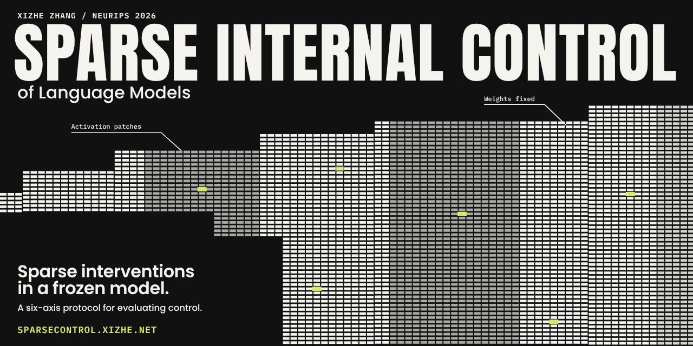
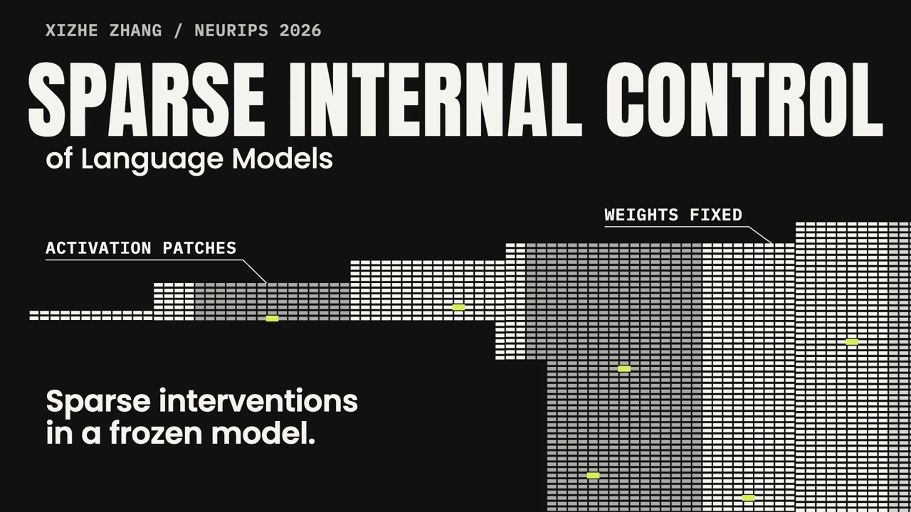
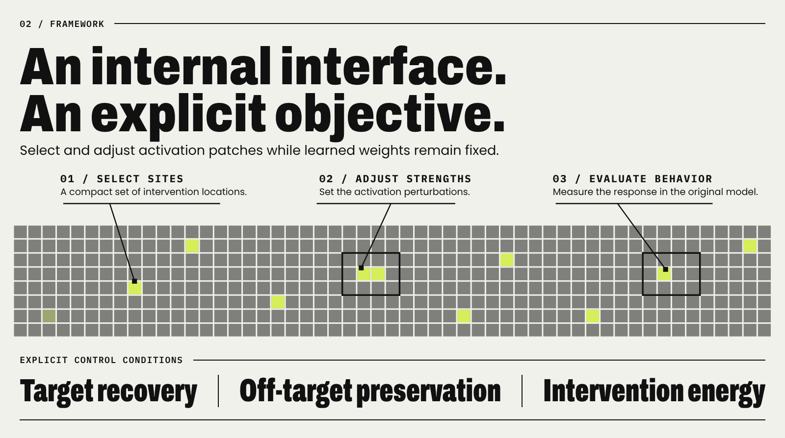
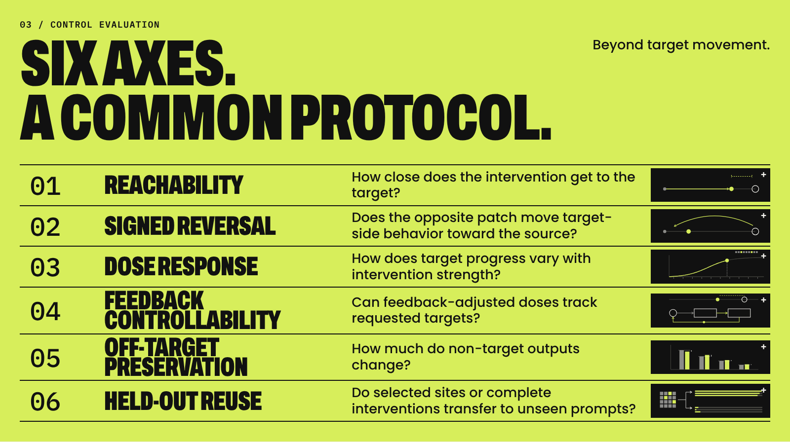
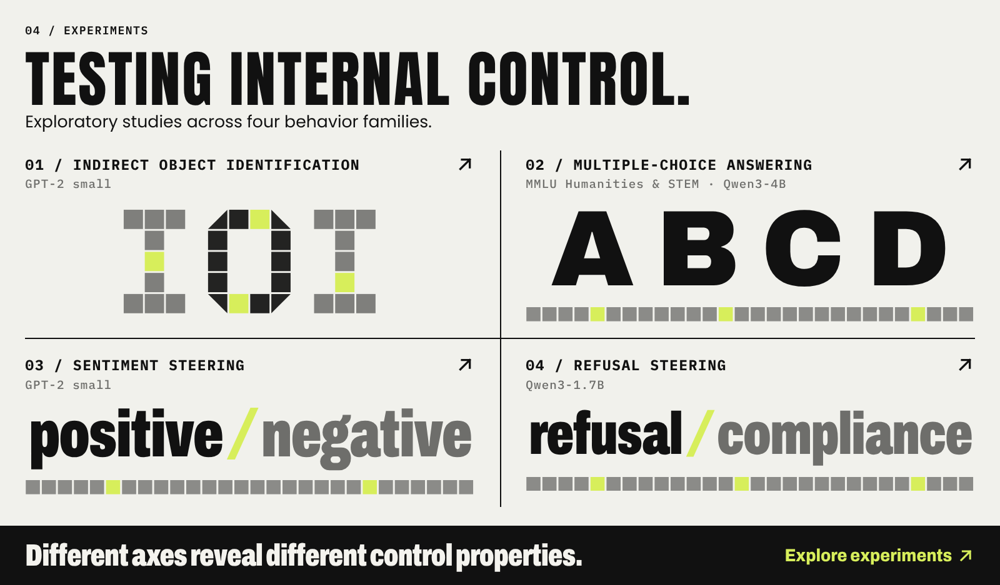

<a href="https://sparsecontrol.xizhe.net"></a>

<div align="center">

# Sparse Internal Control of Language Models

**张锡哲**（Xizhe Zhang）· NeurIPS 2026

[](https://sparsecontrol.xizhe.net)
[](https://sparsecontrol.xizhe.net/paper.pdf)
[](https://sparsecontrol.xizhe.net/theory.html)
[](https://sparsecontrol.xizhe.net)
[](https://github.com/zxzok/sparse-internal-control/actions/workflows/replay.yml)
[](LICENSE)
[](pyproject.toml)

**[项目网站](https://sparsecontrol.xizhe.net)** &nbsp;·&nbsp; **[论文 PDF](https://sparsecontrol.xizhe.net/paper.pdf)** &nbsp;·&nbsp; **[宣传视频](#宣传视频)** &nbsp;·&nbsp; **[理论与数学模型](https://sparsecontrol.xizhe.net/theory.html)** &nbsp;·&nbsp; [快速复算](#无需-gpu-的结果复算) &nbsp;·&nbsp; [实验说明](docs/experiments.md) &nbsp;·&nbsp; [复现范围](REPRODUCIBILITY.md) &nbsp;·&nbsp; [English](README.md)

</div>

## 宣传视频

69 秒介绍稀疏内部控制框架与六轴评价协议，1080p 高清。

[](https://sparsecontrol.xizhe.net/media/sparse-control-neurips2026.mp4)

**[▶ 播放视频](https://sparsecontrol.xizhe.net/media/sparse-control-neurips2026.mp4)** · [GitHub 上的 MP4](https://github.com/zxzok/sparse-internal-control/blob/gh-pages/media/sparse-control-neurips2026.mp4) · [音频来源](https://github.com/zxzok/sparse-internal-control/blob/gh-pages/media/MUSIC-AND-LICENSES.md)

> [!TIP]
> **项目网站：[sparsecontrol.xizhe.net](https://sparsecontrol.xizhe.net)**。用交互动画讲解控制框架与六轴协议，并附[数学模型](https://sparsecontrol.xizhe.net/theory.html)。

论文 **Sparse Internal Control of Language Models** 的代码与测量记录，作者为 **张锡哲**（Xizhe Zhang）。

## 核心思想

稀疏内部控制在推理时通过少数内部位点操控一个冻结的语言模型：干预在前向传播中给少量激活加上缩放后的方向，权重保持不变，强度取零即恢复原模型。位点的选择被表述为一个控制问题：选哪些驱动点、推多大、有何保证。

<a href="https://sparsecontrol.xizhe.net/#framework"></a>

| 步骤 | 内容 | 公式 |
|---|---|---|
| **指定**<br>Specify | 选定读出、每条提示的目标，以及不应改变的非目标提示 | $q_i = \tau_i - b_\theta(x_i)$ |
| **施加**<br>Actuate | 少数位点与方向获得强度 $\beta$，权重 $\theta$ 冻结 | $h_s(x) \leftarrow h_s(x) + \sum_{v:\, s_v = s} \beta_v\, u_v(x)$ |
| **认证**<br>Certify | 在完整模型中同时检查目标误差、非目标变化与能量 | $`\mathrm{Rel}_{\mathrm{tar}} \le \varepsilon`$, $`L_{\mathrm{off}} \le \delta`$, $`E \le \kappa`$ |

```math
\min_{\beta \in \mathbb{R}^{M}}\ \lVert\beta\rVert_{0,c} + \lambda_E\, E(\beta) \quad \text{subject to}\quad \beta \text{ is an } (\varepsilon, \delta, \kappa) \text{ certificate}
```

**Driver-OMP** 以稀疏残差拟合逼近所需位移；**Coverage-Driver** 按跨提示的饱和覆盖逐个加入候选。在未打补丁的模型附近，能否到达目标归结为张成条件与最小能量，详见[理论页](https://sparsecontrol.xizhe.net/theory.html)中的可控性交互演示。

## 六轴评价协议

推动一次只是演示。控制意味着你能**命中**目标、**撤销**它、**调节**它、**跟踪**它、**不扰动**其余一切，并在从未见过的提示上**复用**它。

<a href="https://sparsecontrol.xizhe.net/#protocol"></a>

| 轴 | 问题 | 通过条件 |
|---|---|---|
| 可达性 Reachability | 干预能把读出推到离目标多近？ | 留出读出上 $\mathrm{Rel}_{\mathrm{tar}}(1) \le 0.4$ |
| 符号反转 Signed reversal | 反向补丁能否把目标侧行为拉回 source？ | 对目标侧输入施加 $-\beta$ 后 $\mathrm{Reversal}(\beta) \ge 2$ |
| 剂量响应 Dose response | 目标进展如何随干预强度变化？ | 十个剂量上带符号 Spearman $\rho \ge 0.95$ |
| 反馈可控性 Feedback controllability | 反馈调整的剂量能否跟踪指定目标？ | 终点误差不超过 $\tau_{\mathrm{ctrl}}$：IOI 与 MCQA 为 0.3，Refusal 为 0.1 |
| 非目标保持 Off-target preservation | 非目标输出改变了多少？ | $\mathrm{KL} \le 0.001$，种子均值与每条提示均满足 |
| 留出复用 Held-out reuse | 选出的位点或完整干预能否迁移到未见提示？ | 以连续恢复率报告，区分重拟合强度与冻结强度 |

## 主要发现

- **方向信息决定表现。** 使用 evaluation-pair 方向时，Coverage-Driver 在 MCQA 与 Sentiment 上 8/8 个种子通过可达性；使用 training-mean 方向时一个也不通过。MCQA Humanities 的反馈命中从 46/48 降到 8/48。
- **有序不等于可逆。** Refusal 的 48 条剂量曲线全部 $\rho = 1$，却没有一条通过符号反转。
- **保持并非免费。** MCQA 与 Sentiment 没有任何种子满足 $\mathrm{KL} \le 0.001$；Refusal 上 Driver-OMP 按均值规则有 4/8 个种子通过。
- **位点可迁移，冻结的干预不行。** 模块级 MCQA（Humanities）在未见提示上重拟合强度时恢复率为 0.992，整个干预冻结时仅 0.021。

## 实验

<a href="https://sparsecontrol.xizhe.net/#experiments"></a>

| 行为类别 | 模型 | 主要样本 |
|---|---|---|
| 间接宾语识别 IOI | GPT-2 small | 64 组配对提示 |
| 情感操控 Sentiment | GPT-2 small | 16 对，拟合/评价 8/8；剂量实验用正负各 16 个模板 |
| 多项选择 MMLU Humanities、STEM | Qwen3-4B | 每个学科 24 题，拟合/评价 12/12 |
| 拒答操控 Refusal | Qwen3-1.7B | 20 对，拟合/评价 10/10 |

全部实验系列（含 Qwen3-8B 与 Mistral-7B 的模型对比）见[实验说明](docs/experiments.md)。

## 内容

- 21 组实验配置及执行入口。
- 272 组完整 source/target/patched 任务读出，对应 39 个条件组和 195 项阈值分类。
- 3,072 条逐提示、逐种子的 KL 测量。
- 重建 13 张数值表、3 张定义/配置表、阈值及 Sentiment 零位移敏感性统计的代码。
- 输入、保存的干预、模型配置、数据说明、测试与引用信息。

论文图的底层测量记录和对应关系见 [experiments/figure_records.json](experiments/figure_records.json)。仓库不含绘图代码、图片、模型权重或完整词表 logits 数组。

## 无需 GPU 的结果复算

使用 Python 3.12，在仓库之外建立环境和输出目录：

```bash
git clone https://github.com/zxzok/sparse-internal-control.git
cd sparse-internal-control

python3.12 -m venv ../sic-replay-env
source ../sic-replay-env/bin/activate
python -m pip install -r requirements/replay.lock.txt
python -m pip install --no-deps -e .

python -m sparse_control check-release --manifest
python -m sparse_control reproduce --output ../paper-replay
python -m sparse_control verify --output ../paper-replay
python -m pytest -q
```

Windows PowerShell 使用 `..\sic-replay-env\Scripts\Activate.ps1` 激活环境。

`reproduce` 从测量记录生成表格与统计；`verify` 检查完整性、论文数值、表号与静态表定义、逐种子结果、均值、标准差及阈值分类，不需要另一个独立验证脚本。部分结果复算应在两个命令中使用相同的 `--artifacts` 参数。每次运行使用新的输出目录。

未安装模型依赖或缺少显式模型 fixture 的测试会标记为跳过。GitHub Actions 仅运行 CPU 记录复算，不启动语言模型实验。

## 运行模型实验

请阅读 [实验说明](docs/experiments.md)、[资源与环境配置](docs/compute_resources.md)和[复现范围](REPRODUCIBILITY.md)。完整命令示例见 [英文 README](README.md#running-model-experiments)。

模型实验需独立环境、相应依赖和模型权重。`--plan` 只打印配置；实际执行应指定新的 `--output` 目录。固定干预评价使用保存的支持与系数；完整拟合通过 `--stage full` 执行。两者不会自动覆盖用于论文的测量记录。

## 指标与范围

- `Rel_tar` 用 source 到 target 的位移归一化；`R_clean` 用 clean 输出范数归一化，不能直接互换。
- P 为 evaluation-pair 方向，F 为 training-mean 方向。F 反馈仍可调整剂量，与完全冻结的开环复用不同。
- Sentiment 分别评价非配对剂量响应与配对固定剂量复用，未单独评价反馈跟踪。
- 保持性表格由逐提示 KL 标量重建；重新计算每个 KL 测量需要运行模型实验，定义仍是全词表 KL。
- 保存记录的复算不等于完整模型复现；原始输入和运行身份的缺失情况见 [REPRODUCIBILITY.md](REPRODUCIBILITY.md)。

## 文档与引用

[数据字典](docs/data_dictionary.md) · [方法说明](docs/methods.md) · [实验配置](docs/experiments.md) · [第三方素材](docs/third_party_assets.md)

引用信息见 [CITATION.cff](CITATION.cff) 和 [英文 README](README.md#citation)。代码采用 [Apache License 2.0](LICENSE)，版权与许可证变更历史见 [NOTICE](NOTICE)（1.1.0 及以前版本为 MIT），专利相关承诺见 [PATENTS.md](PATENTS.md)；第三方数据和模型遵循各自许可证。

问题反馈请使用 [GitHub Issues](https://github.com/zxzok/sparse-internal-control/issues)，附实验 ID、命令、环境及错误或数值差异。
